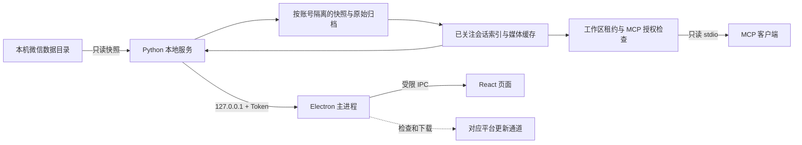

# 系统架构与边界

适用对象：维护者。本文描述当前源码的运行结构；各平台安装版状态单独见 [STATUS](STATUS.md)；具体代码入口见 [MODULES](MODULES.md)，必须保持的行为见 [CONTRACTS](CONTRACTS.md)。

## 一个应用，两个本机进程

Electron 主进程启动 Python 本地服务；React 页面只通过受限 preload IPC 与主进程通信。主进程持有本地 API Token、代理请求与媒体地址，不把 Token 或 SQLite 文件直接交给页面。本地 HTTP API 只绑定 `127.0.0.1`，端口由启动时分配。

MCP 是同一个已打包 Python 服务的 `--mcp` 模式，须通过当前产品账号工作区租约与 MCP 授权检查。关闭窗口留在后台不等于退出应用；完全退出或工作区租约失效后拒绝读取。普通读取不会刷新，显式同步工具的权限和行为见 [CONTRACTS](CONTRACTS.md)。其结果可能被连接的 AI 客户端发送给第三方模型，详见 [DATA-AND-SECURITY](DATA-AND-SECURITY.md)。

## 数据处理链

1. **账号发现**：读取微信配置路径和少量常见目录，只预览联系人与头像快照；用户选择后才注册资料库。
2. **快照与解锁**：复制微信数据库及相关文件，在应用自己的目录中验证密钥、合并 WAL 并解密可识别的数据库；微信源目录保持只读。
3. **累计归档**：Windows 按既有后台周期刷新；Mac 按当前账号保存的同步设置运行，不能把旧每小时周期套用于所有平台。所有已观察到的原始消息行进入账号独立的累计归档，与短期快照代数分开。
4. **选择性解释**：仅已关注会话进入明文索引、搜索和媒体预取。后关注的会话从已有归档补建索引。
5. **阅读**：桌面 UI 通过本地服务读取索引。

Mac 当前固定处理已选单账号：密钥验证后先解密通讯录，再逐库处理消息，其余库随后完成。目录先于消息写入索引，首次关注引导可在后台解析期间使用。Mac 对全部可读本机消息建立索引，关注仅控制桌面及新开启的 AI 直接连接的默认展示范围；未关注不停止底层解析。Windows 继续上述选择性索引流程。

Mac 托管归档在已验证代中保留私有 `.source-base` 解密基底。主库 inode、大小、mtime、ctime 及密钥版本未变时，WAL 单独变化可复用该基底；主库 checkpoint、替换、密钥变化或基底缺失时重新复制解密。APFS 支持时创建独立 inode 的写时复制快照，其他文件系统回退普通复制；不使用可写硬链接。WAL 逐帧检查连续盐值，排除未提交尾部，只解密最终提交状态中每个页的最后版本，包括溢出页。仍完整扫描复制后的 WAL 并执行 `quick_check`，尚未实现跨轮 WAL 追加游标；缓存基底校验失败会回退全量处理。清单提交后才清理旧代，按账号使用崩溃后由系统释放的写锁拒绝重叠刷新。

明文索引在每个账号自己的 index 内保存已完成阶段的源文件版本；不变的消息分片、元数据和通讯录阶段跳过，失败不推进缓存，索引重建重新初始化。导入明文库的 WAL 也参与版本检查。变化分片仍使用现有消息游标和回看范围，回看范围之外的历史原地修改仍需显式全量重建，不能把此缓存描述成任意历史修改捕获能力。媒体后台队列继续按账号、消息版本去重和退避；单个下载连续处理，不再逐文件固定等待 1 秒，每工作约 250 ms 短暂让出 10 ms。消息刷新期间不取新下载任务，正在传输的任务在分块边界等待刷新释放锁，停止请求仍可打断等待；刷新结束会唤醒媒体队列，避免新索引媒体等待空闲轮询。下载不持有刷新锁，传输并发与大小上限不变。选任务不再整批载入历史任务；同步内本地媒体预取每批最多尝试 100 项，失败退避持久化，后续同步继续。严格倒计时、手动及 AI 主动同步行为不变。

微信账号对应独立资料库、索引、归档和快照；Mac 密钥保存在钥匙串，当前界面固定已选微信账号。产品账号切换则切换整个受授权工作区，不合并资料。细节见 [DATA-AND-SECURITY](DATA-AND-SECURITY.md)。

## 运行与发布边界

Mac 日常源码位于 `~/Noteford`，资料位于 `Data/`，应用位于 `/Applications/Noteford.app`；Windows 布局和平台更新通道见 [OPERATIONS](OPERATIONS.md)。完全退出会停止后台同步。只有用户明确授权才构建、安装或发布。Mac 当前取钥只操作临时副本，不重签原版微信；[早期可行性记录](macos-feasibility.md) 属于历史原型。

为何采用这些边界，见 [DECISIONS](DECISIONS.md)。当前兼容与发布风险见 [STATUS](STATUS.md)。

## 官方 MCP 首版

仍由同一个 Python 服务的 stdio 模式读取既有索引，不新增独立数据服务、CLI 或外部 HTTP API。桌面主进程管理本地授权并生成与当前安装绑定的插件；MCP 每次请求只读核对授权。mcp_access.py 负责范围读取，mcp_changes.py 负责索引变更协议，indexer.py 在索引初始化时原子安装事件表与触发器。业务查询继续复用 repository.py。

所有 AI 分析、计划、汇报和任务状态留在客户端。官方首版覆盖本机 stdio；远程 MCP 是未来独立验收范围。
